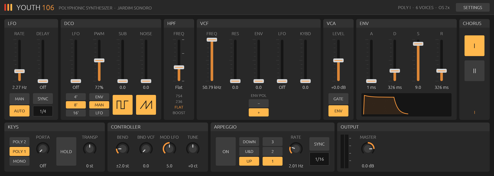

# Youth106

**A Roland Juno-106 emulation for modern DAWs, by Jardim Sonoro.**

Youth106 is a free, non-commercial study in hardware simulation: a
six-voice Juno-106 rebuilt in Rust with the [truce](https://github.com/truce-audio/truce)
plugin framework. The sound engine follows the 106's actual design: the
voice CPU firmware math, the IR3109 ladder filter, the multiplexed DAC
timing and the MN3009 BBD chorus. The interface is a flat, Ableton-style
panel laid out in the Juno-106's own section order.



- Formats: **VST3**, **AU**, **CLAP** (macOS, Apple Silicon release; builds on Windows/Linux from source)
- 128 original Juno-106 factory patches (banks A and B) + Init
- Every control is an automatable host parameter, with real units shown in the DAW

## Install (macOS, Apple Silicon)

1. Download `Youth106-macOS-arm64.zip` from [Releases](../../releases) and unzip.
2. Copy the bundles to your plug-in folders:
   - `Youth106.vst3` → `~/Library/Audio/Plug-Ins/VST3/`
   - `Youth106.component` → `~/Library/Audio/Plug-Ins/Components/`
   - `Youth106.clap` → `~/Library/Audio/Plug-Ins/CLAP/`
3. The bundles are ad-hoc signed, not notarized. Clear the download quarantine once:
   ```sh
   xattr -dr com.apple.quarantine ~/Library/Audio/Plug-Ins/VST3/Youth106.vst3 \
     ~/Library/Audio/Plug-Ins/Components/Youth106.component ~/Library/Audio/Plug-Ins/CLAP/Youth106.clap
   ```
4. Optional: copy the `Presets` folder contents to `~/Library/Audio/Presets/Jardim Sonoro/Youth106/`
   for the factory patches in VST3 hosts (AU and CLAP carry them inside the bundle).
5. Rescan plug-ins in your DAW. In Ableton Live: *Plug-Ins › VST3 (or Audio Units) › Jardim Sonoro › Youth106*.

## Using it

Play it from any MIDI track. Pitch bend, mod wheel (CC1) and sustain pedal
(CC64) work as standard. Controls: drag to change, **Shift**-drag for fine
moves, **double-click** to reset, mouse wheel for small steps.

### Top row — the Juno-106 panel

| Section | Controls | What it does |
|---|---|---|
| **LFO** | Rate, Delay, Auto/Man, Sync + division | Global triangle LFO. Delay fades it in after a key press (Auto: only when all keys were up; Man: on every key or mod-wheel move). Sync locks it to the DAW tempo. On its own it makes no sound: raise DCO LFO (vibrato), VCF LFO (filter wobble) or set PWM to LFO. The chorus has its own fixed LFO. |
| **DCO** | LFO, PWM, Sub, Noise, Range 16'/8'/4', PWM source, Pulse, Saw | The oscillator. LFO = vibrato depth. PWM = pulse width (manual, or swept by the LFO). Sub = square one octave down. Noise = white noise. Pulse and Saw switch the two main waveforms. |
| **HPF** | 4-position switch | High-pass: bass boost, flat, 236 Hz, 754 Hz. |
| **VCF** | Freq, Res, Env (+/− polarity), LFO, Kybd | 24 dB/oct resonant low-pass; self-oscillates at full Res. Env/LFO set how much the envelope and LFO move the cutoff; Kybd makes it follow the keyboard. |
| **VCA** | Level, Env/Gate | Output level of the patch (±10 dB). Env shapes volume with the envelope; Gate is on/off with the key. |
| **ENV** | A, D, S, R | One envelope for both the VCF and VCA, with a live shape preview. |
| **CHORUS** | I, II | The 106's stereo BBD chorus: I is gentle, II is faster. Pressing both gives the Juno-60's I+II mode, which the 106 doesn't have. |

A real 106's chorus also adds a hiss that slowly swaps between left and
right (each MN3009 leaks more noise when its clock is slow, and the two BBDs
are swept in antiphase). Youth106 leaves that hiss out; the chorus
modulation, filtering and BBD saturation are modeled as on the hardware.

### Bottom row — performance

| Section | Controls | What it does |
|---|---|---|
| **KEYS** | Mono/Poly 1/Poly 2, Porta, Hold, Transpose | Poly 1: release tails ring out. Poly 2: notes reuse voices, so only the latest note keeps its release. Mono: all six voices on one note (the 106's unison). Porta = glide time. Hold sustains notes (the sustain pedal does the same). |
| **CONTROLLER** | Bend, Bend VCF, Mod LFO, Tune | Pitch-bend range in semitones, how much bend moves the filter, how much the mod wheel adds LFO vibrato, and fine tune. |
| **ARPEGGIO** | On, Up/U&D/Down, 1–3 octaves, Rate, Sync + division | Arpeggiator over held notes (a Juno-6/60 feature, included as an extra). |
| **OUTPUT** | Meter, Master | Output level. |

### Settings (header button)

Voices (6/8/10), Oversampling (1×/2×/4×, default 2×), Velocity (off on the
real 106), Mono Retrigger, Unison Drift (adds detune in Mono; 0 = hardware),
Analog Noise (the noise floor, mains hum and chorus clicks of the original;
0 removes it),
and **HW Res** — hardware resolution: 7-bit panel sliders (the filter
cutoff moves in ~1.3-semitone steps), portamento and bend updated every
4.2 ms, and an 8-bit bender, like the real firmware. Leave it off for
smooth automation.

## The audio path

```
 MIDI ─► voice assignment (Poly 1 / Poly 2 / Mono, as in the 106's ROM)
          │
          ▼  × 6 voices (or 8/10), firmware tick at ~234 Hz
   ┌──────────────────────────────────────────────────────────────┐
   │ DCO (saw + pulse + sub, one free-running counter; saw height  │
   │      set by the DCO CV) + NOISE                               │
   │   → coupling cap → IR3109 4-pole OTA ladder VCF (BA662 loop)  │
   │   → coupling cap → VCA (measured exponential converter)      │
   │ Envelope, VCF CV and VCA CV are integers written to a         │
   │ multiplexed DAC, each voice at its own time slot, then RC     │
   │ smoothed — exactly as the D7811G voice CPU does.              │
   └──────────────────────────────────────────────────────────────┘
          │ summed at 2× sample rate, half-band decimated
          ▼
   HPF (boost / flat / 236 / 754 Hz) → analog noise floor + mains ripple
          ▼
   VCA LEVEL (µPC1252H2, ±10 dB) → output pole
          ▼
   MN3009 BBD chorus, two lines in antiphase → stereo (dry + wet per side)
          ▼
   Master
```

Source map: `src/dsp/` — `voice.rs` (voice + DAC timing), `osc.rs` (DCO),
`vcf.rs` (filter), `adsr.rs` (envelope), `firmware.rs` (CPU math, tables),
`lfo.rs`, `filters.rs` (HPF, decimator), `chorus.rs`, `noise.rs`, `arp.rs`,
`mod.rs` (voice assignment and the global chain). UI in `src/ui/`.

## How it was made

1. **Reference port.** The engine starts from the Juno-106 model of the
   open-source [Ultramaster KR-106](https://github.com/kayrockscreenprinting/ultramaster_kr106)
   (GPL-3.0), which is built on ROM disassembly of the 106's voice CPU and on
   measurements of real units: the envelope's integer math and ROM tables,
   the firmware's cutoff routine, a VCF cutoff table measured at every
   DAC code, the VCA curve, the LFO speed table, and ngspice-verified chorus
   filters. Only the Juno-106 path was ported. Its own keyboard and MIDI
   handling were left out in favour of standard DAW MIDI.
2. **Checking against the service manual.** The Roland *Juno-106 Service
   Notes* (1984, `juno106_service_manual.pdf`) were read section by section: specifications, circuit
   descriptions, the module and jack board schematics and the adjustment
   procedure. The firmware scales match the official specs (VCF env ±14 oct,
   LFO and bend ±3.5 oct, key follow +3/−2 oct, cutoff 5 Hz–50 kHz,
   DCO LFO ±400 cents), and the per-voice tolerances match the calibration
   limits.
3. **Community knowledge.** Electric Druid's DCO analysis, Roland's own
   notes on assign modes, Juno chorus measurements and forum discussions
   about stepping, unison and calibration were used to cross-check behaviour.
4. **Corrections from that research** (beyond the reference):
   - **Chorus:** the 106's jack board has one chorus LFO and just two control
     lines. Working through the Schmitt-trigger/integrator circuit shows I and
     II differ only in rate (0.514 / 0.835 Hz), at the **same** delay depth.
     I+II is a Juno-60 mode, kept only as a labelled extra.
   - **DCO phase:** the 8253 counters free-run, so notes never restart the
     oscillator phase, and unison voices sit at fixed, arbitrary phase
     offsets instead of detuning (drift now defaults to 0).
   - **DCO CV coupling:** the saw's height is the DCO CV divided by
     frequency, and the pulse is "ramp above the PWM CV". The CV is a
     per-voice sample-and-hold, so after pitch jumps the ramp height and the
     pulse width briefly move, as on the hardware.
   - **Hardware resolution mode:** the firmware's 7-bit sliders and 4.2 ms
     pitch frames, as an option.
   - **No chorus hiss:** the BBD hiss is deliberately not modeled.
   - Output calibrated for DAW gain staging (a full chord fits under 0 dBFS
     at Master 0 dB), and factory PWM values scaled to the 106's 0–105 range.

   `docs/PHASE2.md` lists every finding, the page references and what
   remains open.

## Build from source

```sh
cargo install cargo-truce
cargo truce install        # build + install VST3/AU/CLAP
cargo truce run            # standalone
cargo test --release       # 26 DSP and plugin tests
cargo truce validate       # auval, pluginval, clap-validator
```

Validation: AU passes auval; VST3 passes pluginval at strictness 10. The
CLAP build fails clap-validator's three `state-reproducibility` tests;
truce's own example synth fails the same three, so the problem is in the
framework's CLAP wrapper, not this plugin.

## Credits and license

- DSP derived from the Ultramaster KR-106 by Karl LaRocca et al. (GPL-3.0);
  ROM disassembly by Gordon Pearce.
- Plugin framework: truce (MIT/Apache-2.0).
- Juno-106 and factory patch data © Roland Corporation. Youth106 is an
  independent, non-commercial project, not affiliated with Roland.

Youth106 is licensed under **GPL-3.0-or-later**.
